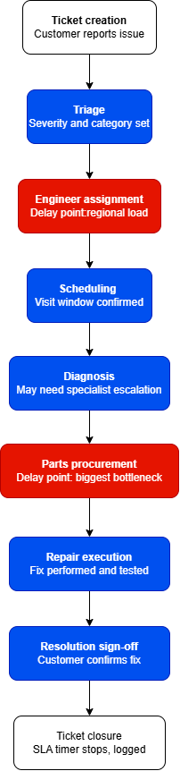
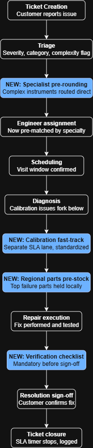
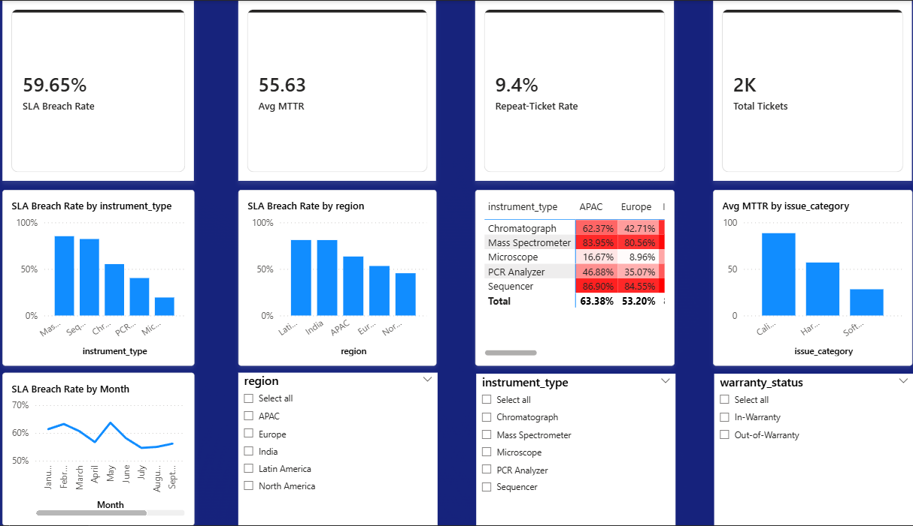
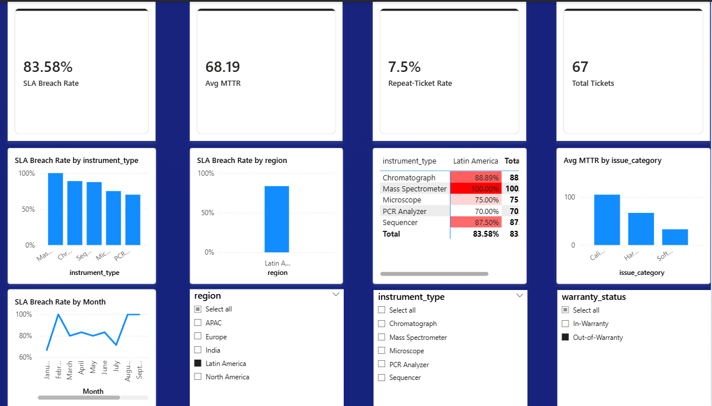

# Lab Instrument Service & Warranty Analytics

A Business Analyst portfolio project analyzing field service operations for lab instruments (mass spectrometers, sequencers, PCR analyzers, chromatographs, microscopes), simulating a real-world service ticket lifecycle to identify SLA breach drivers, repair-time inefficiencies, and repeat-failure patterns — with a set of proposed process improvements and an interactive Power BI dashboard.

Built with a life-sciences instrument manufacturer/service provider in mind (e.g. Thermo Fisher Scientific), where instrument uptime and warranty service quality are core to the customer relationship.

## Business Problem

Thermo Fisher Scientific's Field Service organization manages installation, maintenance, and repair of lab instruments under service contracts and warranty agreements. Timely resolution of service tickets is critical, as instrument downtime directly halts customer research, diagnostics, or production workflows.

A significant proportion of service tickets breach contracted SLA turnaround times, and some instruments generate repeat tickets for the same issue shortly after repair — but the root causes had not been systematically analyzed. This project analyzes ticket-level data to identify the key drivers of SLA breaches and repeat repairs, and proposes targeted process improvements.

Full write-up: [`BRD_Lab_Instrument_Service_Warranty_Analytics.md`](./BRD_Lab_Instrument_Service_Warranty_Analytics.md)

## Project Structure

1. **Business Case & Stakeholder Analysis** — problem statement, objectives, and a stakeholder Power/Interest grid
2. **As-Is Process Mapping** — swimlane diagram of the service ticket lifecycle, with delay points annotated
3. **Data Simulation** (`generate_dataset.py`) — generates a realistic 2,000-row service ticket dataset (`liswa_service_tickets.csv`) with built-in patterns (regional staffing gaps, instrument complexity effects) to mirror real field-service dynamics
4. **Root-Cause Analysis** (`root_cause_analysis.py`) — SLA breach rate, Mean Time to Repair (MTTR), and repeat-ticket rate broken down by instrument type, region, and issue category
5. **Gap Analysis & To-Be Process** — proposed process redesign addressing the root causes identified
6. **Business Requirements Document (BRD)** — functional requirements and cost-benefit business case for the proposed changes
7. **Interactive Dashboard** — Power BI dashboard with KPI summary, breach-rate breakdowns, a heatmap, and live filtering

## Process Flow

**As-Is Process** (with delay points flagged):

<!--  -->

**To-Be Process** (with proposed interventions inserted):

<!--  -->

## Project Management (Jira)

This project was run as a 4-sprint Jira board (project key `LISWA`), with epics covering Business Case, As-Is Process, Data Simulation, Root-Cause Analysis, Gap Analysis & To-Be, BRD, Dashboard Build, and Change Management.

<!--  -->

## Key Findings

- **Overall SLA breach rate: 59.7%**
- Worst-performing segment: **Mass Spectrometer tickets in Latin America/India (~96–98% breach rate)**
- **MTTR: 55.6 hours overall**; Calibration issues have the highest MTTR (88.5 hrs) despite lower technical complexity
- **Repeat-ticket rate: 9.3%** overall, concentrated in the same high-breach instrument/region segments
- Breached tickets cost **~$115 more on average** than tickets resolved within SLA

## Interactive Dashboard (Power BI)

Built directly on the simulated dataset, with a KPI summary row, SLA breach-rate breakdowns by instrument type and region, an instrument × region breach-rate heatmap, MTTR by issue category, a monthly breach-rate trend line, and slicers (region, instrument type, warranty status) for live filtering.

<!--  -->

<!--  -->

For example, filtering to Latin America alone shows the SLA breach rate jump from 59.65% (overall) to 81.09%, with Mass Spectrometer/Sequencer tickets in that region breaching ~97-98% of the time — directly validating the root-cause findings below.

## Proposed Process Improvements

1. **Specialist pre-routing** for complex instruments (Mass Spectrometer, Sequencer) at the triage stage, rather than after initial diagnosis fails
2. **Regional parts pre-stocking** for top failure components in high-breach regions
3. **Dedicated fast-track workflow** for Calibration tickets, separate from general hardware repairs
4. **Mandatory post-repair verification checklist** to reduce repeat tickets

## Tools Used

- **Python** (pandas, numpy, Faker) — data simulation and analysis
- **Jira** — project management (Epics/Sprints/Kanban board)
- **Power BI** — interactive dashboard
- **draw.io** — As-Is / To-Be process diagrams

## Files

- `generate_dataset.py` — simulates the service ticket dataset
- `liswa_service_tickets.csv` — generated dataset (2,000 tickets)
- `root_cause_analysis.py` — SLA/MTTR/repeat-ticket breakdown analysis
- `BRD_Lab_Instrument_Service_Warranty_Analytics.md` — full Business Requirements Document
- `RTM.md` — Requirements Traceability Matrix tracing each requirement to its root cause and validation criteria
- `diagrams/` — As-Is and To-Be process diagrams, Jira board, and dashboard screenshots

---
*This is a self-directed portfolio project built to demonstrate Business Analyst skills — stakeholder analysis, process mapping, data-driven root-cause analysis, requirements documentation, and dashboard design — using simulated data, as real Thermo Fisher Scientific service data is not publicly available.*